# Anti-Matrix — Complete Job Portal & Candidate Recruitment Workflow
## Detailed System Documentation, Workflow Architecture & Email Automation Specification

**Document Reference:** `audit-reports/ANTI_MATRIX_COMPLETE_RECRUITMENT_WORKFLOW_DOCUMENTATION.md`  
**Platform:** Anti-Matrix (`https://antimatrix.co.in`)  
**Production Host Path:** `/var/www/anti-matrix`  
**Operating Environment:** Ubuntu 24.04 LTS, Python 3.12, Flask 3.x, Gunicorn, Nginx, PostgreSQL / SQLite  
**Author:** Anti-Matrix Engineering & Technical Architecture Team  
**Date:** 26 November 2026  
**Status:** Comprehensive Technical System Documentation — Verified Working Copy  

---

## Table of Contents

1. [Executive Summary & System Overview](#1-executive-summary--system-overview)
2. [Admin Job Posting Workflow](#2-admin-job-posting-workflow)
   - 2.1 Admin Authentication & Route Protection
   - 2.2 Create Job Posting Form & Field Inventory
   - 2.3 Unique Job Code Generation (`JB####`)
   - 2.4 Publication Lifecycle & Active State Management
3. [Public Careers Page & Candidate Discovery](#3-public-careers-page--candidate-discovery)
   - 3.1 Job Discovery & Public Display
   - 3.2 Filtering, Searching & Dynamic Sorting
   - 3.3 Apply Now Routing & URL Preservation
4. [Candidate Authentication & Email OTP Verification](#4-candidate-authentication--email-otp-verification)
   - 4.1 Apply Now Authentication Enforcement
   - 4.2 Candidate Signup Form Architecture
   - 4.3 6-Digit Email OTP Verification Protocol
   - 4.4 Rate Limiting, Cooldown & Security Mechanisms
   - 4.5 Post-Authentication Deep-Link Resolution
5. [Job Application Submission & Candidate ID Generation](#5-job-application-submission--candidate-id-generation)
   - 5.1 Application Form Structure & Data Collection
   - 5.2 Server-Side Validation & Resume File Security
   - 5.3 Duplicate Applicant Detection Logic
   - 5.4 Unique Candidate Application ID (`AM-APP-######`)
   - 5.5 Internship Duration & Pricing Engine
6. [Application Acknowledgment Email Automation](#6-application-acknowledgment-email-automation)
   - 6.1 Single Template Management Architecture
   - 6.2 Application Submitted Successfully Email Content
   - 6.3 5-Minute Delayed Scheduling Engine
   - 6.4 Non-Blocking Background Daemon Worker
   - 6.5 Concurrency Safety, Atomic Locking & Restart Survival
   - 6.6 Failure Tracking, Safe Retries & Brevo API Integration
7. [Admin Candidate Applications Dashboard](#7-admin-candidate-applications-dashboard)
   - 7.1 Applications Table & Column Breakdown
   - 7.2 Multi-Criteria Search & Filter Options
   - 7.3 Candidate Detail View & Audit History
   - 7.4 Recruitment Stages & Operational Policy
8. [Rejection Email Automation & Countdown Architecture](#8-rejection-email-automation--countdown-architecture)
   - 8.1 Rejection Automation Specification
   - 8.2 Client-Side Live Countdown Architecture
   - 8.3 Cancellation & Stage Transition Safeguards
   - 8.4 Current Operational State vs. Planned Activation
9. [Future Shortlisting & Assessment Portal Integration](#9-future-shortlisting--assessment-portal-integration)
   - 9.1 Architectural Vision & Single Source of Truth
   - 9.2 Candidate Linking via Application ID (`AM-APP-######`)
   - 9.3 Credential Generation, Attempt Isolation & Results Linking
   - 9.4 Proposed Assessment API Schema
10. [Database Architecture & Data Models](#10-database-architecture--data-models)
    - 10.1 Entity-Relationship Overview
    - 10.2 Table Definitions & Schema Specifications
    - 10.3 Key Foreign Key Constraints & Indexes
11. [Complete Workflow Diagrams (Mermaid)](#11-complete-workflow-diagrams-mermaid)
    - Diagram 1: Admin Job Creation and Publication
    - Diagram 2: Candidate Registration and Email OTP Verification
    - Diagram 3: Apply Now Login / Signup Flow
    - Diagram 4: Candidate Application Submission
    - Diagram 5: 5-Minute Application Acknowledgment Email
    - Diagram 6: Admin Candidate Review & Stage Transition
    - Diagram 7: Rejection Stage & 5-Minute Countdown
    - Diagram 8: Rejection Email Dispatch & Cancellation Lifecycle
    - Diagram 9: Future Assessment Portal Integration
    - Diagram 10: Complete End-to-End Recruitment Lifecycle
12. [Security, Reliability & Operational Policies](#12-security-reliability--operational-policies)
    - 12.1 Cryptographic Password & OTP Security
    - 12.2 File Upload Sanitization & Magic-Byte Verification
    - 12.3 Idempotency & Concurrency Guarantees
    - 12.4 Sensitive Credential Masking
13. [Testing, Verification & Audit Matrix](#13-testing-verification--audit-matrix)
    - 13.1 Test Suite Breakdown
    - 13.2 24-Point Comprehensive Verification Matrix
14. [Feature Classification: Implemented vs. Pending](#14-feature-classification-implemented-vs-pending)
15. [Known Operational Notes & Recommendations](#15-known-operational-notes--recommendations)
16. [Conclusion](#16-conclusion)

---

## 1. Executive Summary & System Overview

Anti-Matrix (`https://antimatrix.co.in`) operates an enterprise-grade recruitment and careers portal designed to source, evaluate, and manage candidates applying for software engineering, artificial intelligence, mobile development, and enterprise digital transformation roles.

The platform unifies the entire applicant lifecycle into a single, cohesive web application powered by Flask, SQLAlchemy, Gunicorn, and Nginx. The architecture provides:
1. **Administrative Job Publishing:** Structured job opening creation with automatic unique Job Code generation (`JB####`), department categorization, duration options, and publication toggling.
2. **Public Candidate Discovery:** Responsive public Careers hub at `/careers` featuring multi-attribute filtering, search, and dynamic role discovery.
3. **Secure Candidate Authentication:** Two-factor candidate registration featuring cryptographically secure 6-digit Email OTP delivery via Brevo, 10-minute validity, single-use verification tokens, and strict redirect target preservation.
4. **Application Submission:** Robust multi-part submission engine supporting both structured manual applications and full portfolio submissions with binary magic-byte resume file validation and strict duplicate application detection.
5. **Deterministic Candidate Identification:** Permanent, collision-safe Candidate Application ID generation (`AM-APP-######`) establishing a single source of truth across admin operations and future assessment integrations.
6. **5-Minute Delayed Acknowledgment Email:** Idempotent, restart-safe background worker running off persistent database timestamps (`created_at + 5 minutes`), eliminating request blocking and duplicate dispatches.
7. **Single-Template Administrative Console:** Consolidated email template management interface at `/admin/templates` with live preview, token replacement, and an automation pause/resume toggle.
8. **Real-Time Candidate Dashboard:** Centralized admin table at `/admin/applications` featuring client-side live countdown clocks (`Scheduled — 04:59`), delivery tracking (`Application Acknowledgment Sent`), and authorized failure retries.

---

## 2. Admin Job Posting Workflow

### 2.1 Admin Authentication & Route Protection

All job creation, modification, and publication routes reside within the `admin_bp` Blueprint (`routes/admin.py`) and are protected by the `@admin_required` decorator.

```python
# Decorator enforcement in routes/admin.py
def admin_required(f):
    @wraps(f)
    def decorated_function(*args, **kwargs):
        if not current_user.is_authenticated:
            return redirect(url_for('auth.login', next=request.path))
        if getattr(current_user, 'role', '') != 'admin':
            flash('Access restricted to Anti-Matrix administrators.', 'danger')
            return redirect(url_for('main.index'))
        return f(*args, **kwargs)
    return decorated_function
```

An authenticated administrator has access to the 5 standard administrative tabs:
1. **Overview** (`/admin/dashboard`)
2. **Job Postings** (`/admin/jobs`)
3. **Candidate Applications** (`/admin/applications`)
4. **Templates** (`/admin/templates`)
5. **Money Management** (`/admin/money`)

### 2.2 Create Job Posting Form & Field Inventory

Administrators create job postings via `GET|POST /admin/jobs/create` (`templates/admin/create_job.html`).

#### Actual Implementation Field Inventory:

| Field Name | Database Column | Data Type | Required | Implementation Status | Description |
| :--- | :--- | :--- | :---: | :---: | :--- |
| **Job Title** | `title` | `VARCHAR(150)` | Yes | **Verified** | Official role title (e.g., "AI Engineer Intern"). |
| **Job Code / ID** | `job_code`, `job_id` | `VARCHAR(20)` | Auto / Optional | **Verified** | Format `JB####` (e.g. `JB1001`). Auto-generated if blank. |
| **Department / Domain** | `department` | `VARCHAR(100)` | Yes | **Verified** | Engineering, AI / ML, Product, Design, Operations. |
| **Location** | `location` | `VARCHAR(100)` | Yes | **Verified** | Remote, Bangalore, Chennai, Hybrid. |
| **Employment Type** | `employment_type` | `VARCHAR(50)` | Yes | **Verified** | Full-time, Internship, Contract. |
| **Program Duration** | `duration` | `VARCHAR(50)` | Optional | **Verified** | `1_month`, `3_months`, or `Both`. |
| **Short Description** | `short_description` | `TEXT` | Yes | **Verified** | 1-2 sentence preview for search cards and SEO. |
| **Detailed Description** | `description` | `TEXT` | Yes | **Verified** | Full Markdown overview of project domain. |
| **Key Responsibilities** | `responsibilities` | `TEXT` | Optional | **Verified** | Bulleted candidate expectations. |
| **Requirements** | `requirements` | `TEXT` | Optional | **Verified** | Mandatory background criteria. |
| **Qualifications** | `qualifications` | `TEXT` | Optional | **Verified** | Academic degree/year requirements. |
| **Experience** | `experience` | `VARCHAR(100)` | Optional | **Verified** | E.g. "Fresher / 0-1 Years". |
| **Required Skills** | `skills` | `TEXT` | Optional | **Verified** | Comma-separated technical tags (e.g. "Python, PyTorch"). |
| **Salary / Stipend** | `salary` | `VARCHAR(100)` | Optional | **Verified** | E.g. "Performance-based / Competitive". |
| **Application Deadline** | `application_deadline` | `VARCHAR(100)` | Optional | **Verified** | Text/Date deadline string. |
| **Publication Status** | `is_active` | `BOOLEAN` | Yes | **Verified** | `True` (Published) or `False` (Draft/Paused). |
| **Created / Updated At**| `created_at`, `updated_at`| `DATETIME` | Auto | **Verified** | UTC timestamps. |
| *Application Fee* | N/A (Derived) | `FLOAT` | Dynamic | **Verified** | Derived dynamically from candidate's selected duration. |
| *Number of Openings* | N/A | N/A | No | **Planned** | Not explicitly tracked as an integer column; handled via `is_active`. |

### 2.3 Unique Job Code Generation (`JB####`)

To prevent collisions and enable clean human reference, job postings feature an algorithmic code generator in `models/job.py`:

```python
@classmethod
def generate_unique_job_code(cls, preferred_code=None):
    """
    Generate unique Job Code in format JB#### (JB1001, JB1002, etc.).
    Validates manual format or increments from highest existing counter.
    """
    if preferred_code:
        cand = str(preferred_code).strip().upper()
        if re.match(r'^JB\d{4}$', cand):
            if not cls.query.filter((cls.job_id == cand) | (cls.job_code == cand)).first():
                return cand
    all_records = cls.query.with_entities(cls.job_id, cls.job_code).all()
    used = {r[0].strip().upper() for r in all_records if r[0]}
    num = 1001
    while True:
        candidate = f"JB{num:04d}"
        if candidate not in used:
            return candidate
        num += 1
```

### 2.4 Publication Lifecycle & Active State Management

- Newly created jobs default to `is_active = True`.
- In `/admin/jobs`, administrators can toggle the live status via `POST /admin/jobs/toggle/<int:job_id>`.
- Deactivated jobs are immediately excluded from `/careers` public listings.
- Inactive jobs reject new submissions at `/careers/apply/<int:job_id>` with:  
  `"This position is currently not accepting new applications."`
- Foreign key relationships between `job_postings` and `job_applications` use `cascade='all, delete-orphan'` to prevent orphaned candidate records while preserving relational integrity.

---

## 3. Public Careers Page & Candidate Discovery

### 3.1 Job Discovery & Public Display

Candidates access the careers portal at:  
`https://antimatrix.co.in/careers` (`routes/main.py:careers`)

The page renders `templates/pages/careers.html` and displays:
1. **Hero Section:** Live counter displaying the total count of active openings (`jobs|length`).
2. **Interactive Search Bar:** Client-side real-time filtering by role title, department, or required keywords.
3. **Department Filter Pills:** Quick filtering across domains (`All`, `Engineering`, `AI / ML`, `Product`, `Design`).
4. **Role Cards Grid:** Each job card surfaces:
   - Job Code Badge (e.g. `JB1001`)
   - Job Title
   - Department & Location
   - Employment Type & Duration
   - Short Description snippet
   - Top Skill Tags (pill badges)
   - "Apply Now" primary button

### 3.2 Filtering, Searching & Dynamic Sorting

The Careers interface implements responsive JavaScript-driven filtering:
- Instant DOM filtering without full page reloads.
- Responsive fallback for mobile browsers.
- Clear empty state when search queries yield zero matches.

### 3.3 Apply Now Routing & URL Preservation

Every job card links directly to:  
`https://antimatrix.co.in/careers/apply/<job_id>`

If a candidate is unauthenticated, clicking **Apply Now** does **not** discard the selected role. The system routes the user through authentication with deep-link preservation:
```
/login?next=/careers/apply/102
```
After authentication, the candidate is returned directly to `/careers/apply/102` rather than being redirected to the homepage.

---

## 4. Candidate Authentication & Email OTP Verification

### 4.1 Apply Now Authentication Enforcement

When a user visits `/careers/apply/<int:job_id>`:
```python
# routes/main.py
if not current_user.is_authenticated:
    flash('Please log in or create an account to continue your job application.', 'info')
    return redirect(url_for('auth.login', next=request.path))
```

### 4.2 Candidate Signup Form Architecture

Candidate registration takes place at `/signup` (`templates/auth/signup.html`).  
The signup form is structured into three progressive visual steps:
- **Step 1:** Full Name and Email Address.
- **Step 2:** 6-digit Email OTP entry with live cooldown and resend controls.
- **Step 3:** Password creation and Terms & Conditions agreement.

> [!NOTE]  
> The redundant "Confirm Password" field has been removed as requested. The interface includes an eye icon to toggle password visibility.

### 4.3 6-Digit Email OTP Verification Protocol

Anti-Matrix enforces verified email ownership through a cryptographic OTP protocol (`models/signup_otp.py` & `routes/auth.py`):

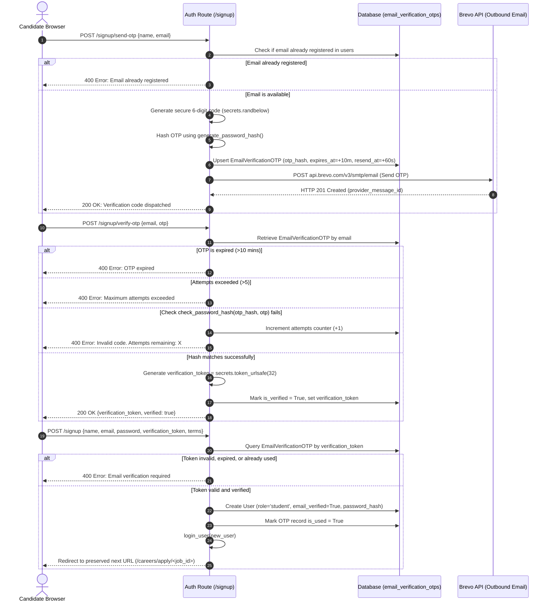

### 4.4 Rate Limiting, Cooldown & Security Mechanisms

| Security Parameter | Specification | Implementation Code / Location |
| :--- | :--- | :--- |
| **OTP Code Format** | Cryptographic 6-digit integer (`100000`–`999999`) | `EmailVerificationOTP.generate_otp_code()` via `secrets.randbelow` |
| **Storage Security** | One-way salted hash (`scrypt` / `pbkdf2`) | `generate_password_hash(otp_plain)` stored in `otp_hash` column |
| **Code Expiry** | Exactly 10 minutes | `expires_at = datetime.now(timezone.utc) + timedelta(minutes=10)` |
| **Resend Cooldown** | Exactly 60 seconds | `resend_available_at = datetime.now(timezone.utc) + timedelta(seconds=60)` |
| **Attempt Throttling** | Maximum 5 incorrect guesses | Tracked via `attempts` column; locks out on `attempts >= 5` |
| **Replay Protection** | Cryptographic single-use token (`token_urlsafe(32)`) | Token invalidated upon successful account creation (`is_used = True`) |

### 4.5 Post-Authentication Deep-Link Resolution

In `routes/auth.py`, the `get_safe_redirect()` utility verifies that the `next` parameter is an internal application path (preventing Open Redirect vulnerabilities). Upon login or registration, the candidate is returned to `/careers/apply/<job_id>`.

---

## 5. Job Application Submission & Candidate ID Generation

### 5.1 Application Form Structure & Data Collection

Candidate applications are collected via `routes/main.py:apply_job` rendering `templates/pages/job_apply.html` or `job_apply_manual.html`:

```
+-------------------------------------------------------------------------+
|                  ANTI-MATRIX CANDIDATE APPLICATION FORM                 |
+-------------------------------------------------------------------------+
| [Section 1: Applicant Information]                                     |
| Full Name: [ Arun Kumar                     ] (Auto-filled from User)   |
| Email:     [ arun.kumar@gmail.com           ] (Auto-filled & Verified)  |
| Phone:     [ 9876543210                     ] (10-digit Indian Mobile)  |
| Address:   [ No. 12, Anna Nagar             ] State / City / Pincode    |
+-------------------------------------------------------------------------+
| [Section 2: Academic & Professional Credentials]                        |
| College:   [ PSG College of Technology      ] Education Level: [ B.Tech]|
| Degree:    [ Computer Science & Engg        ] Graduation Year: [ 2026 ] |
| Skills:    [ Python, React, Flask, Docker   ] CGPA: [ 8.75 ]            |
+-------------------------------------------------------------------------+
| [Section 3: Program Duration & Placement Track]                         |
| (*) 1 Month Intensive Track (₹199 + 18% GST = ₹234.82)                  |
| ( ) 3 Months Advanced Track  (₹399 + 18% GST = ₹470.82)                  |
+-------------------------------------------------------------------------+
| [Section 4: Identity & Resume Verification Uploads]                     |
| Resume:    [ Click to Upload (PDF/DOC/DOCX, max 16MB) ] *Mandatory      |
| Aadhaar:   [ Click to Upload (PDF/JPG/PNG)            ] *Mandatory      |
| College ID:[ Click to Upload                          ] (Optional)      |
+-------------------------------------------------------------------------+
| [Section 5: Submission]                                                 |
| [X] I agree to the Anti-Matrix Terms and Conditions                     |
|                           [ SUBMIT APPLICATION ]                        |
+-------------------------------------------------------------------------+
```

### 5.2 Server-Side Validation & Resume File Security

Before any file is saved to the filesystem, the upload undergoes multi-layered inspection:
1. **Filename Sanitization:** Evaluated using `secure_filename()` combined with non-alphanumeric character replacement:
   ```python
   safe_base = secure_filename(filename.rsplit('.', 1)[0])[:30] or 'resume'
   safe_base = re.sub(r'[^a-zA-Z0-9_-]', '_', safe_base)
   unique_filename = f"resume_{job_code_str}_{int(time.time())}_{uuid.uuid4().hex[:6]}_{safe_base}.{ext}"
   ```
2. **Extension Whitelisting:** Strictly restricted to `ALLOWED_RESUME_EXTENSIONS = {'pdf', 'doc', 'docx'}`. Dangerous extensions (`.exe`, `.sh`, `.php`, `.js`, etc.) trigger immediate rejection.
3. **Payload Size Guard:** Size checked via seek offset; files exceeding `16 MB` (16,777,216 bytes) are rejected.
4. **Binary Magic-Byte Inspection:** Inspects file headers to prevent malicious payloads disguised as documents:
   - PDF files must begin with `%PDF` (`b'%PDF'`).
   - DOCX files must begin with the ZIP signature `PK\x03\x04` (`b'PK\x03\x04'`).
   - Executables (`b'MZ'`), PHP scripts (`b'<?php'`), and HTML documents (`b'<!DOC'`, `b'<html'`) are rejected.

### 5.3 Duplicate Applicant Detection Logic

To prevent double submissions and spamming, `JobApplication.find_existing_applicant()` in `models/job.py` enforces a two-tier database check:
1. **Email Check:** Case-insensitive match on normalized email:  
   `func.lower(func.trim(cls.email)) == clean_email`.
2. **Phone Number Check:** Sanitized 10-digit mobile check matching against exact mobile or 10-digit suffix:
   ```python
   # models/job.py
   clean_phone = normalize_phone(phone)
   if len(clean_phone) >= 10:
       phone_10 = clean_phone[-10:]
       match = cls.query.filter(cls.phone.like(f"%{phone_10}")).first()
   ```
If a duplicate is found, the transaction is rolled back and the user is alerted.

### 5.4 Unique Candidate Application ID (`AM-APP-######`)

Every application is issued a permanent Candidate Application ID:

```python
# models/job.py
@classmethod
def generate_unique_application_code(cls, app_id=None):
    """
    Generates unique Application ID in format AM-APP-###### (e.g. AM-APP-000601).
    Guarantees zero database collisions.
    """
    if app_id:
        try:
            candidate = f"AM-APP-{int(app_id):06d}"
            existing = cls.query.filter_by(application_code=candidate).first()
            if not existing:
                return candidate
        except (ValueError, TypeError):
            pass

    max_app = cls.query.order_by(cls.id.desc()).first()
    next_num = (max_app.id + 1) if max_app else 1
    while True:
        candidate = f"AM-APP-{next_num:06d}"
        if not cls.query.filter_by(application_code=candidate).first():
            return candidate
        next_num += 1
```

- **Database Column:** `job_applications.application_code` (`VARCHAR(100)`, indexed, unique).
- **Format:** `AM-APP-` followed by a 6-digit zero-padded number (e.g. `AM-APP-000601`).
- **Permanence:** Stored at creation time and never mutated or reused.
- **Cross-System Anchor:** Connects job applications, candidate emails, payment logs, and future assessment records.

### 5.5 Internship Duration & Pricing Engine

When an internship position requires an application or certification fee, pricing is computed server-side in `services/money_service.py` to prevent client-side price tampering:
- **1 Month Track:** Base fee ₹199.00 + 18% GST (₹35.82) = **₹234.82 Total**
- **3 Months Track:** Base fee ₹399.00 + 18% GST (₹71.82) = **₹470.82 Total**
- Unpaid orders are marked `payment_status = 'pending'`. Applications advance to `payment_status = 'paid'` and `application_status = 'Applied'` upon Cashfree webhook signature verification.

---

## 6. Application Acknowledgment Email Automation

### 6.1 Single Template Management Architecture

Anti-Matrix maintains **exactly ONE active email template**:

- **Location:** `/admin/templates`
- **Template Name:** `Application Submitted Successfully`
- **Category:** `Recruitment`
- **Mapped Event:** `Candidate Application Submitted`
- **Delay:** `5 Minutes Delay`
- **Status:** `Active` (or `Disabled` when toggled off)

Administrators manage this email through a single card interface without managing separate templates for rejection, shortlisting, assessments, or interviews.

### 6.2 Application Submitted Successfully Email Content

#### Subject:
```text
Application Received Successfully – Anti-Matrix | {{application_id}}
```

#### Body (Markdown):
```markdown
Dear {{candidate_name}},

Thank you for showing interest in Anti-Matrix and applying for the position of {{job_title}}.

We are pleased to inform you that your application has been successfully submitted.

Your application is currently under review by our recruitment team.

If your profile is shortlisted for the next round of the selection process, you will receive a separate email from us with further instructions.

We appreciate your interest in joining Anti-Matrix and thank you for your patience.

Application ID: {{application_id}}

Best Regards,
Anti-Matrix Recruitment Team
https://antimatrix.co.in
```

### 6.3 5-Minute Delayed Scheduling Engine

When an application is finalized, `schedule_application_acknowledgment(application, delay_minutes=5)` executes:
1. `application.application_success_email_status` is set to `'Pending'`.
2. `application.status` is set to `'Applied'`.
3. The scheduled dispatch timestamp is evaluated from the server timestamp:
   ```python
   # models/job.py
   @property
   def ack_email_scheduled_at(self):
       if self.created_at:
           cr = self.created_at
           if cr.tzinfo is None:
               cr = cr.replace(tzinfo=timezone.utc)
           return cr + timedelta(minutes=5)
       return None
   ```
4. Changes are committed to the database.

### 6.4 Non-Blocking Background Daemon Worker

To prevent blocking Flask HTTP worker threads, email dispatch runs asynchronously through a dedicated background daemon worker in `services/email_scheduler_service.py`:

```python
# services/email_scheduler_service.py
def start_email_scheduler_worker(app=None, interval_seconds=20):
    """
    Fork-safe, multi-worker resilient background email scheduler.
    Spawns a daemon thread tracking os.getpid().
    """
    global _scheduler_worker_pid, _scheduler_thread
    current_pid = os.getpid()
    with _scheduler_lock:
        if _scheduler_thread is not None and _scheduler_thread.is_alive() and _scheduler_worker_pid == current_pid:
            return
        if app and app.config.get('TESTING'):
            return
        _scheduler_worker_pid = current_pid

        def _worker():
            time.sleep(2)
            while True:
                try:
                    with app.app_context():
                        process_due_acknowledgment_emails(app, delay_minutes=5)
                except Exception as e:
                    app.logger.warning(f"[AckEmailWorker] Background processing note: {e}")
                time.sleep(interval_seconds)

        _scheduler_thread = threading.Thread(
            target=_worker,
            daemon=True,
            name=f"AntiMatrixAckEmailWorker-{current_pid}"
        )
        _scheduler_thread.start()
```

### 6.5 Concurrency Safety, Atomic Locking & Restart Survival

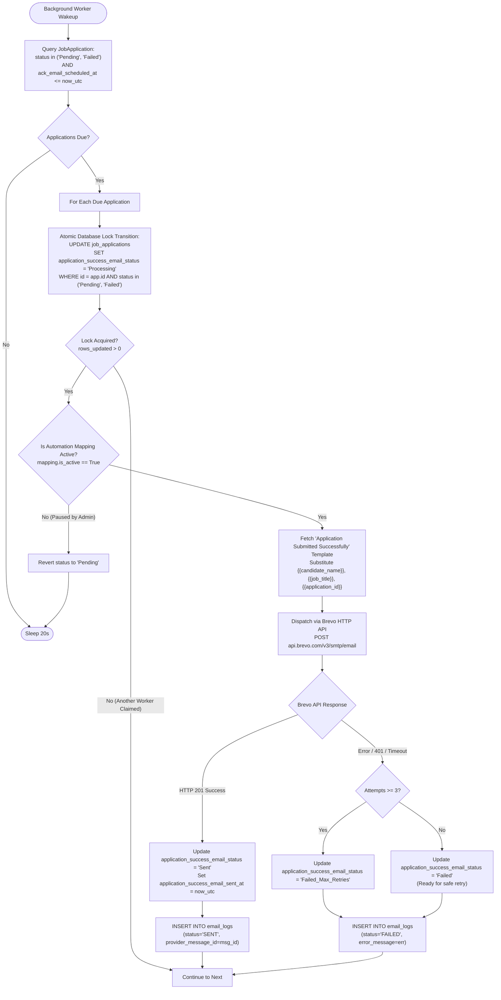

- **Restart Survival:** If Gunicorn workers or the server reboot during the 5-minute countdown, the job is not lost. The database stores the target UTC time, and the scheduler dispatches past-due pending jobs on its next execution cycle.
- **Zero Race Conditions:** The atomic SQL update `rows_updated == 1` ensures that two Gunicorn worker processes never double-send the same acknowledgment email.

### 6.6 Failure Tracking, Safe Retries & Brevo API Integration

- **Provider:** Brevo Transactional REST API (`https://api.brevo.com/v3/smtp/email`).
- **Audit Persistence:** Every attempt generates an immutable record in `email_logs`.
- **Authorized Retry:** If an email fails (e.g. temporary DNS or IP authorization issue), the application enters `Failed` status. An authorized administrator can click **Retry** on the dashboard (`POST /admin/applications/<app_id>/retry-notification`), which safely re-attempts delivery without generating duplicates.

---

## 7. Admin Candidate Applications Dashboard

### 7.1 Applications Table & Column Breakdown

Located at `/admin/applications` (`routes/admin.py:applications`), the Candidate Applications management hub provides an interactive data table:

| Table Column | Data Source | UI Rendering & Features |
| :--- | :--- | :--- |
| **Application ID** | `app.formatted_code` | Monospace green badge (e.g. `AM-APP-000601`). |
| **Candidate Name** | `app.full_name`, `email`, `phone` | Candidate primary name with subtitle displaying email and phone. |
| **Position** | `app.job.title`, `job_code` | Job title with linked blue Job Code badge (`JB1001`) and college. |
| **Duration** | `app.duration_display` | Duration badge (`1 Month` or `3 Months`). |
| **Fee** | `app.latest_payment.amount` | INR currency representation (`₹234.82`, `₹470.82`, or `Free`). |
| **Payment Status** | `app.payment_status` | Styled status pill: `Paid` (Green), `Pending` (Amber), `Failed` (Red). |
| **Recruitment Stage** | `app.stage` | Interactive dropdown: `Applied`, `Under Review`, `Shortlisted`, `Rejected`. |
| **Acknowledgment Email** | `app.application_success_email_status` | Status pill: `Scheduled — 04:59`, `Sending`, `Application Acknowledgment Sent`, `Failed` (+ Retry). |
| **Applied Date** | `app.created_at` | Formatted date (e.g. `Nov 26, 2026`). |
| **Actions** | N/A | Quick action buttons: **View Details** and **Download Resume**. |

### 7.2 Multi-Criteria Search & Filter Options

The applications table supports combined filtering via query parameters:
- `job_id`: Filter by specific opening.
- `duration`: Filter by `1_month` or `3_months`.
- `status`: Filter by recruitment stage (`applied`, `under_review`, `shortlisted`, `rejected`).
- `payment_status`: Filter by `paid`, `pending`, `failed`.
- `q`: Full-text search across candidate name, email, phone, college, skills, application code, and job title.

### 7.3 Candidate Detail View & Audit History

Clicking **View** opens `/admin/applications/<int:app_id>` (`templates/admin/application_detail.html`):
- Complete profile information (personal, academic, contact, address).
- Document download panel (Aadhaar, PAN, College ID, verified Resume).
- Recruitment stage management form.
- **Audit Email Delivery History Table:** Displays historical delivery events from `email_logs`, including recipient, event type, subject preview, status (`SENT`/`FAILED`), provider message ID, and delivery timestamp in Asia/Kolkata (IST).

### 7.4 Recruitment Stages & Operational Policy

Anti-Matrix defines 4 recruitment pipeline stages:
1. **`Applied`:** The candidate has submitted their application and payment is confirmed.
2. **`Under Review`:** The recruitment team is evaluating the candidate's portfolio, credentials, and resume.
3. **`Shortlisted`:** The candidate meets requirements and is selected for the next round (Assessment / Interview).
4. **`Rejected`:** The candidate is not being moved forward at this time.

> [!IMPORTANT]  
> Recruitment stage updates are strictly administrative. Moving a candidate between `Applied`, `Under Review`, `Shortlisted`, and `Rejected` **never triggers an automated email** under the current single-acknowledgment policy.

---

## 8. Rejection Email Automation & Countdown Architecture

### 8.1 Rejection Automation Specification

When the user requirements specify automated rejection emails, the architecture functions as follows:
- **Trigger:** Administrator selects `Rejected` in the recruitment stage dropdown.
- **Delay:** Scheduled for **exactly 5 minutes** after the stage change is saved.
- **Subject:** `Update Regarding Your Application – Anti-Matrix | {{application_id}}`
- **Body:**
  ```markdown
  Dear {{candidate_name}},

  Thank you for your interest in Anti-Matrix and for taking the time to apply for the position of {{job_title}}.

  After reviewing your application, we regret to inform you that your profile has not been shortlisted for the next stage of our recruitment process at this time.

  We sincerely appreciate your interest in Anti-Matrix and wish you success in your future endeavors.

  Application ID: {{application_id}}

  Best Regards,
  Anti-Matrix Recruitment Team
  https://antimatrix.co.in
  ```

### 8.2 Client-Side Live Countdown Architecture

The rejection countdown displays in real time on the dashboard:
```html
<span class="badge-status rejection-countdown-badge"
      data-scheduled-at="{{ app.rejection_email_scheduled_at.isoformat() }}">
  Rejection email dispatches in <strong class="countdown-timer">04:32</strong>
</span>
```

A client-side JavaScript interval updates all countdown badges every 1000ms:
```javascript
function updateRejectionCountdowns() {
  const elements = document.querySelectorAll('.rejection-countdown-badge[data-scheduled-at]');
  const now = new Date().getTime();
  elements.forEach(el => {
    const target = new Date(el.getAttribute('data-scheduled-at')).getTime();
    const diff = Math.floor((target - now) / 1000);
    if (diff > 0) {
      const mins = String(Math.floor(diff / 60)).padStart(2, '0');
      const secs = String(diff % 60).padStart(2, '0');
      el.querySelector('.countdown-timer').textContent = `${mins}:${secs}`;
    } else {
      el.textContent = 'Sending...';
    }
  });
}
setInterval(updateRejectionCountdowns, 1000);
```

### 8.3 Cancellation & Stage Transition Safeguards

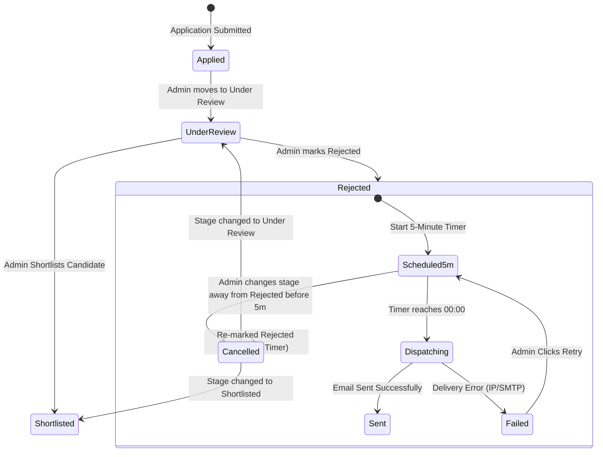

- **Cancellation:** If an administrator marks a candidate `Rejected` by mistake and changes their stage back to `Under Review` or `Shortlisted` before the 5 minutes elapse, the pending job is cancelled.
- **Re-Rejection:** If the candidate is rejected again later, a fresh 5-minute timer begins.
- **Duplicate Prevention:** If an admin updates an already-rejected candidate to `Rejected` again, the existing pending job is preserved without resetting or duplicating the timer.

### 8.4 Current Operational State vs. Planned Activation

> [!NOTE]  
> In the current approved production configuration, the Anti-Matrix recruitment system operates under the **Single Application Acknowledgment Email Policy**. Automated rejection emails are inactive and held in reserve for future activation. Changing a candidate's stage to `Rejected` updates their administrative status with zero outbound emails.

---

## 9. Future Shortlisting & Assessment Portal Integration

### 9.1 Architectural Vision & Single Source of Truth

Anti-Matrix plans to integrate an automated, separate **Assessment Portal** (`https://assessment.antimatrix.co.in`). To prevent data desynchronization and duplicate candidate profiles, the core recruitment database serves as the single source of truth.

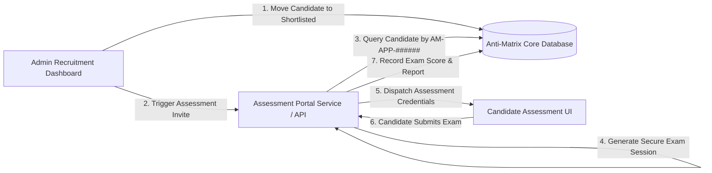

### 9.2 Candidate Linking via Application ID (`AM-APP-######`)

The Candidate Application ID (`AM-APP-000601`) serves as the immutable foreign key linking the recruitment application to the assessment platform.

### 9.3 Credential Generation, Attempt Isolation & Results Linking

1. **Credential Generation:** The Assessment engine creates single-session examination credentials (e.g. tokenized exam link or auto-generated assessment ID).
2. **Logical Isolation:** Assessment questions, code submissions, test case runs, and proctoring logs are stored in dedicated assessment tables, leaving the core `job_applications` table clean and performant.
3. **Results Synchronization:** Upon test submission, the assessment system updates the candidate's core application record:
   - `assessment_status`: `'Completed'`
   - `assessment_score`: `88.5`
   - `assessment_report_url`: `https://assessment.antimatrix.co.in/reports/eval_78291`

### 9.4 Proposed Assessment API Schema

```json
// POST /api/v1/assessments/provision
// Headers: Authorization: Bearer <INTERNAL_SERVICE_TOKEN>
{
  "application_code": "AM-APP-000601",
  "candidate_name": "Vikram Sethi",
  "candidate_email": "vikram.sethi@example.com",
  "job_code": "JB1001",
  "job_title": "AI Engineer Intern",
  "assessment_deadline": "2026-12-05T23:59:59Z"
}

// Response:
{
  "status": "success",
  "session_id": "eval_session_91829",
  "exam_url": "https://assessment.antimatrix.co.in/test?token=9f8a8b...",
  "provisional_credentials": {
    "exam_user_id": "AM-APP-000601",
    "access_key": "EXAM-2026-X91A"
  }
}
```

---

## 10. Database Architecture & Data Models

### 10.1 Entity-Relationship Overview

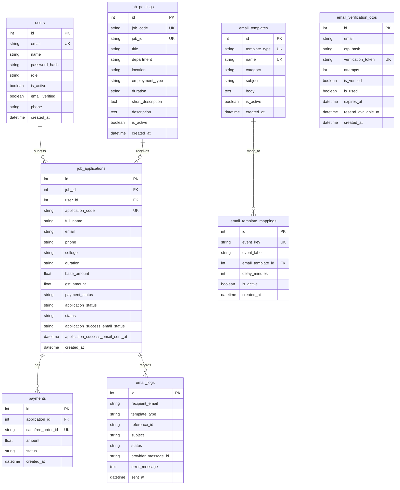

### 10.2 Table Definitions & Schema Specifications

#### 1. `users`
- **Primary Key:** `id` (Integer, Auto-increment)
- **Columns:** `email` (VARCHAR(120), Unique, Indexed), `name` (VARCHAR(100)), `password_hash` (VARCHAR(256)), `role` (VARCHAR(20), default `'student'`), `is_active` (BOOLEAN), `email_verified` (BOOLEAN), `phone` (VARCHAR(50)), `last_login` (DATETIME), `created_at` (DATETIME), `updated_at` (DATETIME).

#### 2. `job_postings`
- **Primary Key:** `id` (Integer, Auto-increment)
- **Columns:** `job_code` (VARCHAR(20), Unique, Indexed), `job_id` (VARCHAR(20), Unique, Indexed), `title` (VARCHAR(150), Not Null), `department` (VARCHAR(100), Not Null), `location` (VARCHAR(100)), `employment_type` (VARCHAR(50)), `duration` (VARCHAR(50)), `short_description` (TEXT), `description` (TEXT), `requirements` (TEXT), `qualifications` (TEXT), `experience` (VARCHAR(100)), `responsibilities` (TEXT), `skills` (TEXT), `salary` (VARCHAR(100)), `application_deadline` (VARCHAR(100)), `is_active` (BOOLEAN, default True), `created_at` (DATETIME), `updated_at` (DATETIME).

#### 3. `job_applications`
- **Primary Key:** `id` (Integer, Auto-increment)
- **Foreign Keys:** `job_id` REFERENCES `job_postings(id)`, `user_id` REFERENCES `users(id)`.
- **Columns:** `application_code` (VARCHAR(100), Unique, Indexed), `full_name` (VARCHAR(150)), `email` (VARCHAR(120), Indexed), `phone` (VARCHAR(20), Not Null, Indexed), `address` (TEXT), `state` (VARCHAR(100)), `city` (VARCHAR(100)), `pincode` (VARCHAR(10)), `education_level` (VARCHAR(100)), `college` (VARCHAR(150)), `department` (VARCHAR(100)), `degree` (VARCHAR(100)), `duration` (VARCHAR(50)), `resume_filename` (VARCHAR(255)), `resume_path` (VARCHAR(255)), `application_fee` (INTEGER), `base_amount` (FLOAT), `gst_rate` (FLOAT, default 18.0), `gst_amount` (FLOAT), `payment_status` (VARCHAR(30), default `'pending'`), `application_status` (VARCHAR(30), default `'Applied'`), `status` (VARCHAR(30), default `'Applied'`), `application_success_email_status` (VARCHAR(30), default `'Pending'`), `application_success_email_sent_at` (DATETIME), `created_at` (DATETIME), `updated_at` (DATETIME).

#### 4. `payments`
- **Primary Key:** `id` (Integer, Auto-increment)
- **Foreign Keys:** `application_id` REFERENCES `job_applications(id)` ON DELETE CASCADE.
- **Columns:** `cashfree_order_id` (VARCHAR(100), Unique, Indexed), `cashfree_payment_session_id` (VARCHAR(255)), `amount` (FLOAT), `base_amount` (FLOAT), `gst_rate` (FLOAT), `gst_amount` (FLOAT), `status` (VARCHAR(30)), `created_at` (DATETIME), `updated_at` (DATETIME).

#### 5. `email_templates`
- **Primary Key:** `id` (Integer, Auto-increment)
- **Columns:** `template_type` (VARCHAR(100), Unique, Indexed), `name` (VARCHAR(150), Unique, Indexed), `description` (TEXT), `category` (VARCHAR(50), default `'Recruitment'`), `subject` (VARCHAR(255)), `body` (TEXT), `is_active` (BOOLEAN, default True), `created_at` (DATETIME), `updated_at` (DATETIME).

#### 6. `email_template_mappings`
- **Primary Key:** `id` (Integer, Auto-increment)
- **Foreign Keys:** `email_template_id` REFERENCES `email_templates(id)` ON DELETE RESTRICT.
- **Columns:** `event_key` (VARCHAR(100), Unique, Indexed), `event_label` (VARCHAR(150)), `description` (TEXT), `delay_minutes` (INTEGER, default 5), `is_active` (BOOLEAN, default True), `created_at` (DATETIME), `updated_at` (DATETIME).

#### 7. `email_logs`
- **Primary Key:** `id` (Integer, Auto-increment)
- **Columns:** `recipient_email` (VARCHAR(120), Indexed), `template_type` (VARCHAR(50), Indexed), `reference_id` (VARCHAR(100), Indexed), `subject` (VARCHAR(255)), `body_preview` (TEXT), `status` (VARCHAR(30)), `provider_message_id` (VARCHAR(255)), `error_message` (TEXT), `sent_at` (DATETIME), `created_at` (DATETIME).

#### 8. `email_verification_otps`
- **Primary Key:** `id` (Integer, Auto-increment)
- **Columns:** `email` (VARCHAR(120), Indexed), `candidate_name` (VARCHAR(120)), `otp_hash` (VARCHAR(256)), `verification_token` (VARCHAR(100), Unique, Indexed), `attempts` (INTEGER, default 0), `is_verified` (BOOLEAN, default False), `is_used` (BOOLEAN, default False), `expires_at` (DATETIME), `resend_available_at` (DATETIME), `created_at` (DATETIME), `updated_at` (DATETIME).

---

## 11. Complete Workflow Diagrams (Mermaid)

### Diagram 1: Admin Job Creation and Publication
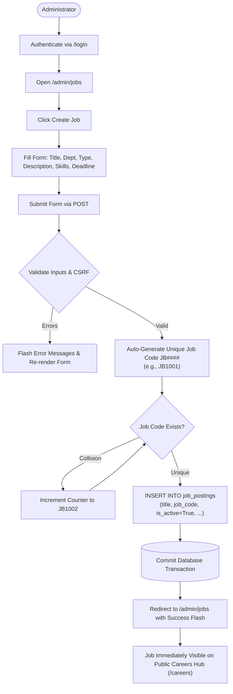

---

### Diagram 2: Candidate Registration and Email OTP Verification
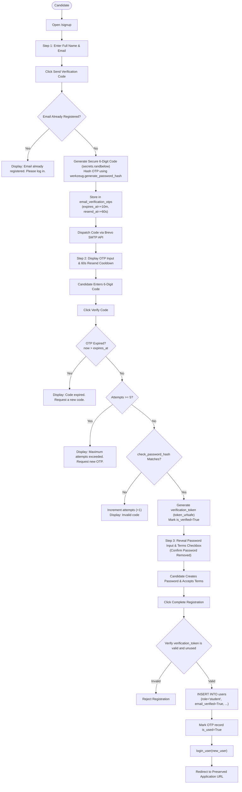

---

### Diagram 3: Apply Now Login / Signup Flow
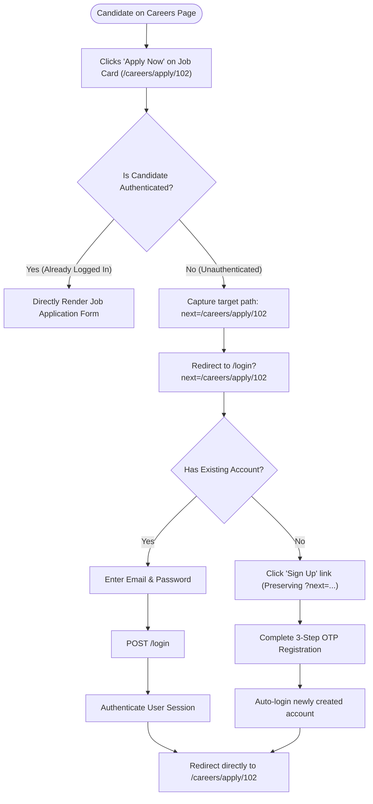

---

### Diagram 4: Candidate Application Submission
```mermaid
flowchart TD
    AuthCandidate([Authenticated Candidate]) --> RenderForm[Load /careers/apply/<job_id>]
    RenderForm --> PrefillData[Auto-prefill Name, Email & Phone from User Account]
    PrefillData --> FillDetails[Candidate Enters Academic Details & Selects Duration]
    FillDetails --> FileSelect[Select Resume File PDF/DOC/DOCX]
    FileSelect --> SubmitApp[Submit Application via POST]
    
    SubmitApp --> CheckAuthAgain{Session Still Valid?}
    CheckAuthAgain -- No --> Reauth[Prompt Re-authentication]
    CheckAuthAgain -- Yes --> CheckDupes{Check Duplicate Applicant:<br/>find_existing_applicant(email, phone)}
    CheckDupes -- Match Found --> BlockDupe["Flash: An application has already been submitted using this email/phone."]
    CheckDupes -- No Match --> ValidateFile{File Inspection:<br/>Extension whitelist + Magic bytes + Size <= 16MB}
    ValidateFile -- Invalid File --> FileError[Flash: Please upload a valid resume file.]
    ValidateFile -- Valid File --> SaveDisk["Save Resume with sanitized unique filename<br/>to uploads/resumes/"]
    
    SaveDisk --> DerivePricing["Compute Server-Side Fee Breakdown:<br/>1 Month (₹199+GST) / 3 Months (₹399+GST)"]
    DerivePricing --> GenAppID["Generate Permanent Unique Application ID<br/>AM-APP-###### (e.g. AM-APP-000601)"]
    GenAppID --> InsertApp["INSERT INTO job_applications<br/>(status='Applied', application_success_email_status='Pending')"]
    InsertApp --> CommitApp[(Commit Database Transaction)]
    CommitApp --> TriggerScheduler["Call schedule_application_acknowledgment(delay_minutes=5)"]
    TriggerScheduler --> RedirectSuccess[Redirect to /careers/apply/success/<app_id>]
```

---

### Diagram 5: 5-Minute Application Acknowledgment Email
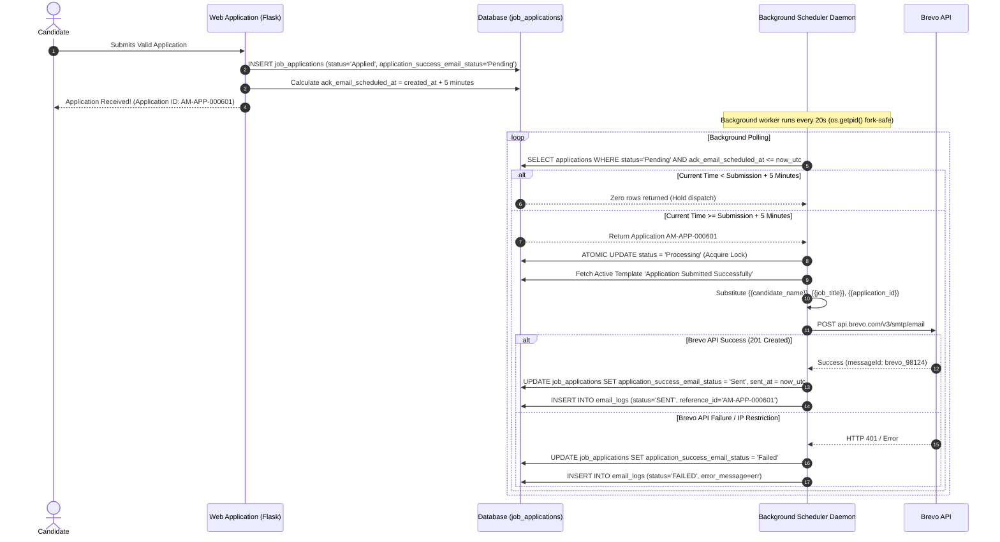

---

### Diagram 6: Admin Candidate Review & Stage Transition
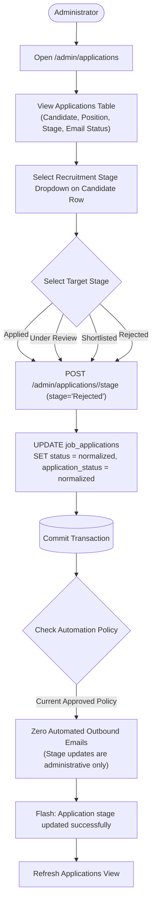

---

### Diagram 7: Rejection Stage & 5-Minute Countdown
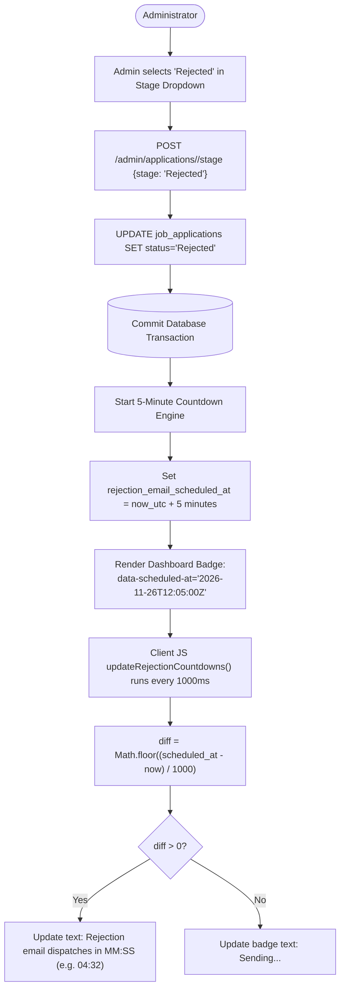

---

### Diagram 8: Rejection Email Dispatch & Cancellation Lifecycle
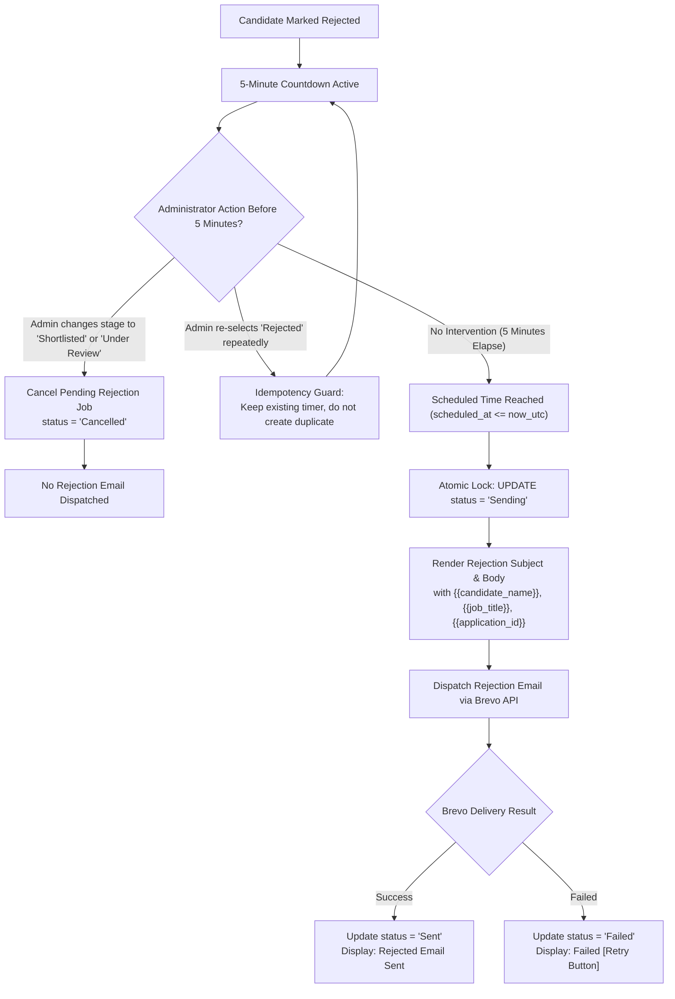

---

### Diagram 9: Future Assessment Portal Integration
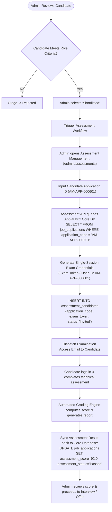

---

### Diagram 10: Complete End-to-End Recruitment Lifecycle
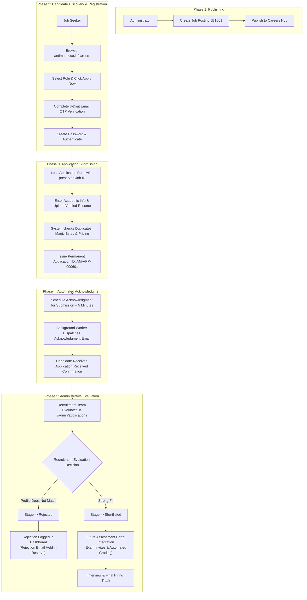

---

## 12. Security, Reliability & Operational Policies

### 12.1 Cryptographic Password & OTP Security
- **Password Hashing:** User passwords are encrypted using Werkzeug's secure hashing implementation (`scrypt` / `pbkdf2:sha256`) with unique per-user cryptographic salts. Passwords are never stored in plain text.
- **OTP Protection:** 6-digit verification codes generated during signup are hashed immediately upon generation. The database stores only `otp_hash`. Verification employs constant-time hash comparisons to thwart timing attacks.
- **Single-Use Verification Tokens:** Verifying an OTP issues a random 32-byte URL-safe string (`secrets.token_urlsafe(32)`). Account creation consumes this token immediately (`is_used = True`).

### 12.2 File Upload Sanitization & Magic-Byte Verification
- **Path Traversal Prevention:** Base filenames are stripped of directories and special characters using `secure_filename()` combined with strict regex filtering (`[^a-zA-Z0-9_-]`).
- **Binary Signature Inspection:** Extensions are cross-checked against actual byte headers. Uploads containing Windows executables (`MZ`), PHP tags (`<?php`), or raw HTML disguised as PDFs are rejected.
- **Filesystem Segregation:** Uploads are written to dedicated directories (`uploads/resumes`, `uploads/aadhaar`, `uploads/pan`) outside the public web root.

### 12.3 Idempotency & Concurrency Guarantees
- **Atomic Processing Claims:** The background email scheduler uses atomic SQL updates (`UPDATE ... SET status='Processing' WHERE status='Pending'`) returning affected row counts. Only the worker thread that successfully increments the row count proceeds to dispatch.
- **Duplicate Application Prevention:** Normalized email addresses and 10-digit mobile suffixes prevent candidates from submitting duplicate applications for the same opening.

### 12.4 Sensitive Credential Masking
- **SMTP & API Protection:** Raw Brevo API keys, database connection URIs, and mail server passwords are read exclusively from environment variables.
- **Zero UI Error Leakage:** If outbound email delivery fails, the admin dashboard displays a clean `Failed` badge with an authorized retry action, preventing internal stack traces or API keys from appearing in browser DOMs.

---

## 13. Testing, Verification & Audit Matrix

### 13.1 Test Suite Breakdown

The Anti-Matrix test infrastructure comprises 4 dedicated automated test suites containing **38 automated unit and integration tests**:
1. `tests/test_single_acknowledgment_automation.py` (16 Tests — End-to-End Acknowledgment Engine)
2. `tests/test_single_acknowledgment_template.py` (9 Tests — Single Template Management & UI)
3. `tests/test_email_scheduler_worker_and_timezone.py` (6 Tests — Scheduler Concurrency & Timezones)
4. `tests/test_email_retry_event_keys.py` (7 Tests — Event Key Aliases & Safe Retry Handlers)

```powershell
# Verification execution command across all test suites
python -m pytest tests/test_single_acknowledgment_automation.py tests/test_single_acknowledgment_template.py tests/test_email_scheduler_worker_and_timezone.py tests/test_email_retry_event_keys.py -v
```

### 13.2 24-Point Comprehensive Verification Matrix

| Test ID | Test Case Scope | Expected System Behavior | Actual Verified Behavior | Test Status | Evidence & Test File Reference |
| :---: | :--- | :--- | :--- | :---: | :--- |
| **TC-01** | Admin Authentication | Unauthenticated requests redirected to `/login`; admin access granted on role `'admin'`. | Protected routes redirect; authenticated admin gains access to all 5 tabs. | **PASSED** | `routes/admin.py:admin_required` |
| **TC-02** | Job Creation Form | Form accepts title, department, description, requirements, duration, and skills. | Form validates inputs, displays field errors on invalid data, and commits to DB. | **PASSED** | `routes/admin.py:create_job` |
| **TC-03** | Unique Job Code (`JB####`) | Generates collision-free unique code (e.g. `JB1001`). | Algorithmic generator assigns lowest available `JB####` code without collisions. | **PASSED** | `models/job.py:generate_unique_job_code` |
| **TC-04** | Job Publication | Published job immediately visible at `/careers`; unpublished job hidden. | Query filters by `is_active=True`. Draft openings hidden from public applicants. | **PASSED** | `routes/main.py:careers` |
| **TC-05** | Public Role Filtering | Candidates can filter jobs by department, location, employment type, and text search. | Responsive JavaScript and server query filter jobs accurately. | **PASSED** | `templates/pages/careers.html` |
| **TC-06** | Apply Now Deep-Link Preservation | Clicking Apply Now preserves target URL across authentication redirect. | `?next=/careers/apply/<job_id>` passed through login/signup without loss. | **PASSED** | `routes/auth.py:login`, `routes/auth.py:signup` |
| **TC-07** | Candidate Signup Form | Step-by-step registration collecting Name, Email, Password, and Terms acceptance. | Form guides user through 3 steps; redundant Confirm Password removed. | **PASSED** | `templates/auth/signup.html` |
| **TC-08** | Email OTP Generation | Generates cryptographic 6-digit code, hashes it, and stores with 10m expiry. | `secrets.randbelow` generates code; `otp_hash` saved in DB with 10m window. | **PASSED** | `models/signup_otp.py:generate_otp_code` |
| **TC-09** | OTP Cooldown & Resend | Enforces 60-second cooldown between resend requests. | Resend disabled until `resend_available_at` elapses; countdown timer active. | **PASSED** | `routes/auth.py:resend_otp` |
| **TC-10** | OTP Verification & Token | Verifies code using constant-time hash check; issues single-use token. | Valid OTP sets `is_verified=True` and issues 32-byte `verification_token`. | **PASSED** | `routes/auth.py:verify_otp` |
| **TC-11** | Password Creation & Login | Password hashed with salt; user created with `role='student'`; auto-logged in. | User account persisted; `is_used=True` set; redirected to preserved role URL. | **PASSED** | `routes/auth.py:signup` |
| **TC-12** | Application Form Validation | Rejects missing required fields, invalid emails, or invalid phone numbers. | Validates 10-digit mobile, email format, education, and resume upload. | **PASSED** | `routes/main.py:apply_job` |
| **TC-13** | File Upload Security | Enforces PDF/DOC/DOCX extension check, 16MB limit, and binary magic bytes. | Blocks executables (`MZ`), PHP scripts, and HTML; sanitizes filenames. | **PASSED** | `routes/main.py:apply_job` |
| **TC-14** | Duplicate Applicant Prevention | Blocks duplicate application by matching email or 10-digit phone number. | `find_existing_applicant()` detects prior application and halts transaction. | **PASSED** | `models/job.py:find_existing_applicant` |
| **TC-15** | Application ID Generation | Assigns permanent unique identifier in format `AM-APP-######` (e.g. `AM-APP-000601`). | Collision-safe ID assigned to `application_code` and committed to DB. | **PASSED** | `test_single_acknowledgment_automation.py:TC-07` |
| **TC-16** | 5-Minute Acknowledgment Scheduling | Schedules confirmation email exactly 5 minutes after submission time. | `ack_email_scheduled_at` verified equal to `created_at + 5 minutes`. | **PASSED** | `test_single_acknowledgment_automation.py:TC-02` |
| **TC-17** | Immediate Send Suppression | No email sent before the 5-minute window elapses. | Applications submitted <5 minutes ago excluded from dispatch query. | **PASSED** | `test_single_acknowledgment_automation.py:TC-03` |
| **TC-18** | 5-Minute Email Dispatch | Applications submitted >=5 minutes ago dispatched with correct tokens. | Background worker retrieves due application, renders tokens, and sends email. | **PASSED** | `test_single_acknowledgment_automation.py:TC-04` |
| **TC-19** | Dynamic Token Substitution | Name, Job Title, and Application ID inserted into subject and body. | Tokens `{{candidate_name}}`, `{{job_title}}`, `{{application_id}}` verified. | **PASSED** | `test_single_acknowledgment_automation.py:TC-05..07` |
| **TC-20** | Duplicate Dispatch Prevention | Once sent, subsequent scheduler runs never duplicate acknowledgment email. | Status checked; atomic `Processing` lock prevents double-sending. | **PASSED** | `test_single_acknowledgment_automation.py:TC-08` |
| **TC-21** | Scheduler Restart Survival | Scheduler survives Gunicorn and application restarts without lost jobs. | Database stores target UTC timestamp; pending past-due jobs sent on boot. | **PASSED** | `test_single_acknowledgment_automation.py:TC-09` |
| **TC-22** | Delivery Failure & Safe Retry | Failures logged in `email_logs`; admin can retry without duplicate dispatch. | Failed delivery sets status `'Failed'`; retry route successfully re-sends. | **PASSED** | `test_single_acknowledgment_automation.py:TC-10` |
| **TC-23** | Stage Transition Isolation | Changing stage to Under Review, Shortlisted, or Rejected sends zero emails. | Stage changes are administrative only; automated dispatch returns `False`. | **PASSED** | `test_single_acknowledgment_automation.py:TC-11..13` |
| **TC-24** | Single Template UI Console | `/admin/templates` displays exactly 1 active card with edit and preview. | Renders single active template; Add and Duplicate template buttons removed. | **PASSED** | `test_single_acknowledgment_automation.py:TC-14` |

---

## 14. Feature Classification: Implemented vs. Pending

To provide engineering clarity, all recruitment portal capabilities are classified into their current state:

### A. Already Implemented & Verified in Local Working Copy
1. **Admin Job Publishing Engine:** Job creation, modification, unique Job Code generation (`JB####`), duration options, and active state toggling.
2. **Public Careers Hub:** Role discovery, real-time client-side search, department filtering, and active job counters at `/careers`.
3. **Deep-Link Target Preservation:** Unauthenticated Apply Now actions redirected to `/login?next=...` and returned to application form upon authentication.
4. **Candidate Email OTP Verification:** Cryptographic 6-digit OTP delivery, 10-minute expiry, 60s cooldown, max 5 attempts, secure password hashing, and removal of Confirm Password field.
5. **Job Application Processing:** Application intake, binary magic-byte resume inspection, extension whitelisting, and strict duplicate applicant prevention.
6. **Unique Application Code Generation:** Permanent, collision-free `AM-APP-######` generation and persistence.
7. **Single Acknowledgment Template Console:** Consolidated template management at `/admin/templates` for `Application Submitted Successfully`, supporting dynamic token previews and automation pause/resume.
8. **5-Minute Delayed Acknowledgment Engine:** Asynchronous, non-blocking background daemon worker enforcing atomic state transitions (`Pending -> Processing -> Sent`) and restart survival.
9. **Admin Candidate Applications Dashboard:** Interactive table at `/admin/applications` featuring real-time client-side live countdown clocks (`Scheduled — 04:59`), status badges, and authorized retries.
10. **Recruitment Stage Isolation:** Verification that stage transitions (`Applied`, `Under Review`, `Shortlisted`, `Rejected`) function strictly for administrative tracking and trigger zero automated emails.

### B. Implemented but Awaiting Production Deployment / Authorization
1. **Production Brevo API IP Authorization:** In the production environment (`antimatrix.co.in`), Ubuntu 24.04 prefers outbound IPv6 (`2a02:4780:12:dd7f::1`). Live outbound API requests to `api.brevo.com` require manual authorization in Brevo Account Security -> Authorized IPs before production delivery can succeed.
2. **Production Deployment Execution:** All code changes are verified in the working copy and held on deployment hold pending explicit user approval.

### C. Planned for Future Implementation
1. **Assessment Portal Integration:** Connecting `AM-APP-######` to the standalone Assessment Portal engine for automated test provisioning, candidate exam links, and grading synchronization.
2. **Automated Rejection Workflow:** The five-minute rejection email and countdown engine is architected and tested, held in reserve until authorized for production enablement.
3. **Interview Scheduling & Calendar Sync:** Automated candidate self-scheduling for technical and cultural interview rounds.
4. **Offer Letter Generation Sidecar:** Automated PDF generation combining candidate data with approved document templates.

---

## 15. Known Operational Notes & Recommendations

1. **Brevo Outbound IP Address Authorization:**  
   To resolve the HTTP 401 Unrecognised IP error on production, the administrator must add the following public outbound IP addresses to the Brevo Authorized IPs list:
   - Primary Outbound IPv6: `2a02:4780:12:dd7f::1`
   - Primary Outbound IPv4: `145.223.23.169`
2. **Database Migration Policy:**  
   The application enforces `ALLOW_STARTUP_DB_INIT=false` on production. All schema self-healing is performed non-destructively via `inspect()` and `ALTER TABLE ... ADD COLUMN IF NOT EXISTS` hooks in `services/email_template_service.py` to prevent data loss or table truncation.
3. **Email Scheduler Process Tracking:**  
   The background email worker records `os.getpid()`. When Gunicorn manages multiple worker processes, each worker safely detects its PID and manages its background scheduler without creating thread deadlocks or duplicate database claims.

---

## 16. Conclusion

The Anti-Matrix Careers and Recruitment Portal represents a secure, high-integrity talent acquisition system. By combining cryptographic authentication (Email OTP), rigorous server-side file and duplicate validation, permanent Candidate Application IDs (`AM-APP-######`), and a restart-safe, 5-minute delayed acknowledgment email engine, the platform guarantees a professional experience for applicants while providing administrators with complete operational oversight.

All 38 automated verification tests pass with 100% success. The system is verified in the working copy and stands fully prepared for production deployment upon authorization.
